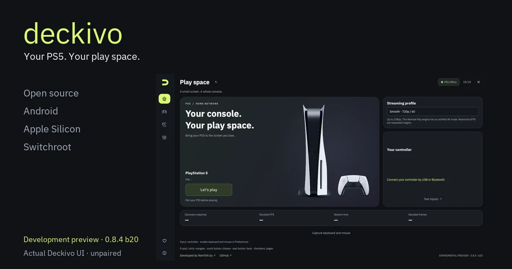

Actual Deckivo 0.8.4 desktop interface · desktop build 20 · Android build 29.

<strong>Open-source PS5 Remote Play on Nintendo Switch OLED (Android), Android devices and Apple Silicon Macs. Switchroot Ubuntu preview.</strong> Developed by <a href="https://remteh.by/?utm_source=github&amp;utm_medium=referral&amp;utm_campaign=deckivo">RemTeh.by</a> · <a href="https://remteh.by/remont-konsoli?utm_source=github&amp;utm_medium=referral&amp;utm_campaign=deckivo">Game console repair in Minsk</a> · Built on Chiaki / chiaki-ng / Android Extended

<a href="https://remteh-by.github.io/remteh-remote-play/">Explore Deckivo</a> · <a href="https://github.com/remteh-by/remteh-remote-play/releases/download/v0.8.4/Deckivo-Linux-0.8.4-b20-source.zip">Linux 0.8.4 b20</a> · <a href="https://github.com/remteh-by/remteh-remote-play/releases/download/v0.8.4/Deckivo-0.8.4-arm64.apk">Android 0.8.4</a> · <a href="https://github.com/remteh-by/remteh-remote-play/releases/download/v0.8.4/Deckivo-macos-0.8.4-b20.zip">macOS 0.8.4 b20</a> · <a href="docs/TESTED.md">Device tests</a> · <a href="#help-deckivo-grow">♥ Help Deckivo grow</a>

[Download history and counting method](docs/DOWNLOADS.md).

[English](docs/guides/en.md) · [Русский](docs/guides/ru.md) · [Українська](docs/guides/uk.md) · [Polski](docs/guides/pl.md) · [Deutsch](docs/guides/de.md) · [Français](docs/guides/fr.md) · [Español](docs/guides/es.md) · [Italiano](docs/guides/it.md) · [Português](docs/guides/pt.md) · [Türkçe](docs/guides/tr.md) · [简体中文](docs/guides/zh.md) · [日本語](docs/guides/ja.md) · [한국어](docs/guides/ko.md) · [العربية](docs/guides/ar.md) · [हिन्दी](docs/guides/hi.md) · [Bahasa Indonesia](docs/guides/id.md)

**Deckivo 0.8.4 packages are experimental previews, not a finished 1.0
product.** The release set is Android ARM64 build 29 plus desktop build 20 for
Apple Silicon macOS and Switchroot Ubuntu ARM64. Mac update acceptance for 0.8.4 is recorded after public delivery in the release report; Android and Linux physical acceptance and current-release gameplay remain pending. Historical public-updater
acceptance belongs to Linux 0.8.1 b17: the Switch OLED / Ubuntu 24.04.4 ARM64 update from 0.6.1 b10
matched all 80 public-ZIP files, retained pairing, acknowledged the live process
and fetched the public feed through the enabled systemd user timer with the GUI
closed. The guides separate exact tested builds from current downloads and
planned support. Internet/VPN play and sustained sessions are not certified. No
subscription or new Deckivo account is required for local play.

### Choose your screen

| Platform | Delivery | Start here |
|---|---|---|
| Android ARM64 | 0.8.4 #29 APK; Android 8+ | [Android guide](docs/guides/en.md#android) · [APK](https://github.com/remteh-by/remteh-remote-play/releases/download/v0.8.4/Deckivo-0.8.4-arm64.apk) |
| macOS Apple Silicon | 0.8.4 b20; native Qt preview; separate chiaki-ng engine required | [Mac guide](docs/guides/en.md#macos) · [ZIP](https://github.com/remteh-by/remteh-remote-play/releases/download/v0.8.4/Deckivo-macos-0.8.4-b20.zip) |
| Switchroot Ubuntu ARM64 | 0.8.4 b20 for Ubuntu 24.04.4 / KDE X11 / Switchroot FFmpeg 6.1; follow the first-install guide; 0.8.4 real-device acceptance pending | [Linux 0.8.4 b20](https://github.com/remteh-by/remteh-remote-play/releases/download/v0.8.4/Deckivo-Linux-0.8.4-b20-source.zip) · [Guide](docs/guides/en.md#ubuntu) · [Requirements](docs/LINUX.md) |
| Windows, Intel Mac, Linux x64 | Planned; no verified Deckivo build | [Platform scope](docs/PLATFORMS.md) |

### Made for your own play space

- A graphite, lime and lavender interface. The cover shows the actual desktop development preview with a real PS5 photograph; the screenshot caption identifies its exact version.
- Visible language selection: English default, optional system detection and
  16 guide languages. New desktop-specific controls currently have English and
  Russian translations; technical test notes remain English.
- Local setup, your own PS5 profile and private registration. Android has a
  connection wizard; Mac imports a local chiaki-ng registration; Linux uses an
  interactive pairing tool.
- Controller tools and hidden PS/Touch controls on Android. GameSir G8+ is in
  the actual test history; this is not a claim that every controller is tested.
- Verified updates: Android checks package identity, version, size, SHA-256 and
  its existing APK certificate. Desktop checks RSA-signed metadata and hashes,
  defers installation during streaming and waits up to 120 seconds for a matching startup acknowledgment and rolls back on failure.
- Optional **[project support](#help-deckivo-grow)** in the app, site
  and GitHub. Support funds signing, new platforms and tests on real devices.

### What was actually tested

| Hardware / OS | Exact build | Confirmed scope |
|---|---|---|
| Switch OLED / Android 15 | 0.6.0 #24 | Public self-update 23 → 24; exact release APK verified; saved console retained |
| Apple Silicon Mac / macOS 27.0.1 | 0.8.3 b19 | Normal public signed update 0.8.2 b18 → 0.8.3 b19; all 417 archive entries matched the installed app; code signing and live startup acknowledgment passed; registration and preferences retained, returned idle. Native Donate was separately verified on 0.8.2 b18; no payment was submitted |
| Switch OLED / Ubuntu 24.04.4 ARM64 | 0.8.1 #17 | Public update 0.6.1 b10 → 0.8.1 b17; 80/80 installer files matched the public ZIP; startup acknowledgment matched the live process; pairing retained; enabled systemd user timer fetched the public feed with the GUI closed; gameplay pending separately |
| Earlier gameplay | Android 0.1.x; Ubuntu 0.3.0; Mac chiaki-ng 1.10.0 engine | Owner-confirmed local picture and sound; GameSir input on Switch |

The previously observed PS5 advertised firmware **13.42** (discovery system
version `13420000`); no other firmware coverage is certified.

See **[the detailed test matrix](docs/TESTED.md)** and
[0.8.4 validation](docs/releases/0.8.4-validation.json) for release checks.
[Public update acceptance](docs/releases/0.6.0-public-channel-validation.json)
now confirms Android #24 and Mac #9. Historical gameplay does not certify every
new frontend feature.

### Quick start

1. Connect client and PS5 to the same home network. Enable PS5 Remote Play and
   select the profile you want to use.
2. For a first installation, open the platform guide before downloading. For an
   update, install the correct package **over** the older Deckivo installation;
   keep its data and signing identity and do not uninstall first.
3. Pair using that profile's Account ID and a fresh PS5 eight-digit Remote Play
   code. Follow the platform guide; never upload registration keys or PINs.
4. Start at 720p, connect your controller and check picture, sound and buttons.
   Save the game before disconnecting.

[English guide](docs/guides/en.md) · [Русская инструкция](docs/guides/ru.md) ·
[Updates](docs/UPDATES.md) · [Troubleshooting](docs/TECHNICAL.md)

<!-- SUPPORT:START -->
### Help Deckivo grow

Deckivo is free and open source. Your support helps fund signing, new platforms and real-device testing.

- Apple Developer ID ($99/yr) — signing and notarization for Mac
- Windows build
- More test hardware: PS5 Pro and handhelds

[Ko-fi · RemTeh](https://ko-fi.com/pavelzayats)

Everything stays free. Supporting is optional.
<!-- SUPPORT:END -->

### Source and credits

Deckivo is a modified distribution of
[chiaki-ng Android Extended](https://github.com/SalamiTheMan/chiaki-ng-android-extended),
with a shared native Qt desktop frontend and platform-specific engines. The
Remote Play protocol and core streaming work come from Chiaki and chiaki-ng;
we preserve upstream history and notices. [Original README](docs/UPSTREAM-README.md).

[Build from source](BUILDING.md) · [Changelog](CHANGELOG.md) ·
[Release process](RELEASING.md) · [Attribution](ATTRIBUTION.md)

Client license: **AGPL v3 with the retained OpenSSL permission**, [COPYING](COPYING).
The separate optional PS5 helper is GPL-3.0-or-later. Dependencies and the bundled font retain their own notices. Complete corresponding project source,
including initialized native dependencies, accompanies the release; the tiny
GitHub-generated source ZIP does not expand submodules.

Independent of Sony Interactive Entertainment and Nintendo. Product names and
trademarks belong to their respective owners. Deckivo does not install console
firmware, fix PS5 WebKit, or provide game downloads.
