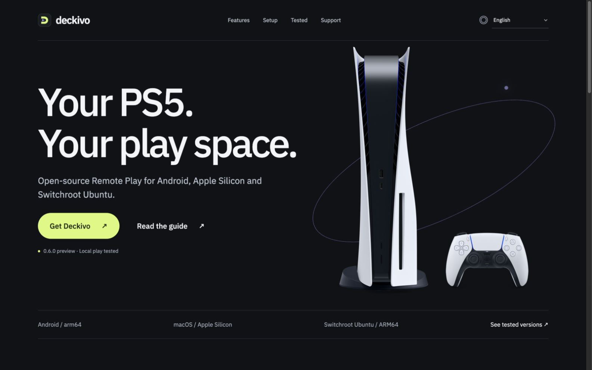

<strong>Open-source PS5 Remote Play for Android, Apple Silicon and Switchroot Ubuntu.</strong> Developed by <a href="https://remteh.by/">RemTeh.by</a> · Built on Chiaki / chiaki-ng / Android Extended

<a href="https://remteh-by.github.io/remteh-remote-play/">Explore Deckivo</a> · <a href="https://github.com/remteh-by/remteh-remote-play/releases/tag/v0.6.0">Download 0.6.0 preview</a> · <a href="docs/TESTED.md">Device tests</a> · <a href="https://ko-fi.com/pavelzayats">♥ Support on Ko-fi</a>

[English](docs/guides/en.md) · [Русский](docs/guides/ru.md) · [Українська](docs/guides/uk.md) · [Polski](docs/guides/pl.md) · [Deutsch](docs/guides/de.md) · [Français](docs/guides/fr.md) · [Español](docs/guides/es.md) · [Italiano](docs/guides/it.md) · [Português](docs/guides/pt.md) · [Türkçe](docs/guides/tr.md) · [简体中文](docs/guides/zh.md) · [日本語](docs/guides/ja.md) · [한국어](docs/guides/ko.md) · [العربية](docs/guides/ar.md) · [हिन्दी](docs/guides/hi.md) · [Bahasa Indonesia](docs/guides/id.md)

**0.6.0 is an experimental prerelease, not a finished 1.0 product.** The guides
separate tested hardware/builds from planned support. Local play has been tested;
Internet/VPN play and sustained sessions are not certified. No subscription or
new Deckivo account is required for local play.

### Choose your screen

| Platform | Delivery | Start here |
|---|---|---|
| Android ARM64 | APK, Android 8+; tested device uses Android 15 | [Android guide](docs/guides/en.md#android) · [APK](https://github.com/remteh-by/remteh-remote-play/releases/download/v0.6.0/Deckivo-0.6.0-arm64.apk) |
| macOS Apple Silicon | Native Qt preview, separate chiaki-ng engine required; ad-hoc signed, not notarized | [Mac guide](docs/guides/en.md#macos) |
| Switchroot Ubuntu ARM64 | Developer preview for Ubuntu 24.04 / KDE X11 / Switchroot FFmpeg 6.1 | [Linux guide](docs/guides/en.md#ubuntu) · [Requirements](docs/LINUX.md) |
| Windows, Intel Mac, Linux x64 | Planned; no verified Deckivo build | [Platform scope](docs/PLATFORMS.md) |

### Made for your own play space

- A graphite, lime and lavender interface, with the original PS5 product photo.
- Visible language selection: English default, optional system detection and
  16 guide languages. New desktop-specific controls currently have English and
  Russian translations; technical test notes remain English.
- Local setup, your own PS5 profile and private registration. Android has a
  connection wizard; Mac imports a local chiaki-ng registration; Linux uses an
  interactive pairing tool.
- Controller tools and hidden PS/Touch controls on Android. GameSir G8+ is in
  the actual test history; this is not a claim that every controller is tested.
- Verified updates: Android checks package identity, version, size, SHA-256 and
  its existing APK certificate. Desktop checks RSA-signed metadata and hashes,
  defers installation during streaming and retains a rollback copy.
- Optional **[Ko-fi · RemTeh](https://ko-fi.com/pavelzayats)** in the app, site
  and GitHub. No paid feature unlock, priority support or individual setup service.

### What was actually tested

| Hardware / OS | Exact build | Confirmed scope |
|---|---|---|
| Switch OLED / Android 15 | 0.5.1 #20 | Self-updates 18 → 19 → 20; registration data retained |
| Apple Silicon Mac / macOS 27.0.1 | 0.5.1 #5 | Self-updates 3 → 4 → 5, relaunch and registration retained |
| Switch OLED / Ubuntu 24.04.4 ARM64 | 0.5.1 #7 | Self-update 6 → 7, restart, pairing/settings/history retained |
| Earlier gameplay | Android 0.1.x; Ubuntu 0.3.0; Mac chiaki-ng 1.10.0 engine | Owner-confirmed local picture and sound; GameSir input on Switch |

The connected PS5 currently advertises firmware **13.42** (discovery system
version `13420000`); no other firmware coverage is certified.

See **[the detailed test matrix](docs/TESTED.md)** and
[0.6.0 validation](docs/releases/0.6.0-validation.json) for release checks.
Historical gameplay does not certify every new frontend feature.

### Quick start

1. Connect client and PS5 to the same home network. Enable PS5 Remote Play and
   select the profile you want to use.
2. Install the correct package **over** an older Deckivo installation. Keep
   data and the same signing identity; do not uninstall to update.
3. Pair using that profile's Account ID and a fresh PS5 eight-digit Remote Play
   code. Follow the platform guide; never upload registration keys or PINs.
4. Start at 720p, connect your controller and check picture, sound and buttons.
   Save the game before disconnecting.

[English guide](docs/guides/en.md) · [Русская инструкция](docs/guides/ru.md) ·
[Updates](docs/UPDATES.md) · [Troubleshooting](docs/TECHNICAL.md)

### Source and credits

Deckivo is a modified distribution of
[chiaki-ng Android Extended](https://github.com/SalamiTheMan/chiaki-ng-android-extended),
with a shared native Qt desktop frontend and platform-specific engines. The
Remote Play protocol and core streaming work come from Chiaki and chiaki-ng;
we preserve upstream history and notices. [Original README](docs/UPSTREAM-README.md).

[Build from source](BUILDING.md) · [Changelog](CHANGELOG.md) ·
[Release process](RELEASING.md) · [Attribution](ATTRIBUTION.md)

Client license: **AGPL v3 with the retained OpenSSL permission**, [COPYING](COPYING).
The separate optional PS5 helper is GPL-3.0-or-later. Dependencies and the Sony
product photo retain their own notices. Complete corresponding project source,
including initialized native dependencies, accompanies the release; the tiny
GitHub-generated source ZIP does not expand submodules.

Independent of Sony Interactive Entertainment and Nintendo. Product names and
trademarks belong to their respective owners. Deckivo does not install console
firmware, fix PS5 WebKit, or provide game downloads.
